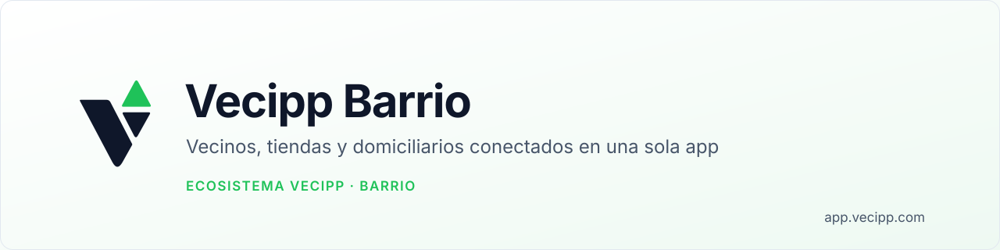
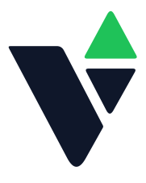

<!-- vecipp:cabecera — generado por aplicar-marca: no editar a mano, se regenera -->

  <picture>
    <source media="(prefers-color-scheme: dark)" srcset=".github/assets/banner-oscuro.svg">
    
  </picture>

  
  
  
  
  
  
  
  
  

  <a href="https://vecipp.com"><b>vecipp.com</b></a> ·
  <a href="https://github.com/DangerDutyJS/Vecipp-Negocio"><b>Vecipp Negocio</b></a> ·
  <a href="https://github.com/DangerDutyJS/Vecipp-Barrio"><b>Vecipp Barrio</b></a> ·
  <a href="https://github.com/DangerDutyJS/Vecipp-IA-Releases"><b>Vecipp IA</b></a>

<!-- /vecipp:cabecera -->

## Vecipp Barrio, la red de tu barrio en una sola app

**Vecipp Barrio** es el mundo de Vecipp para **vecinos, tiendas de barrio y domiciliarios**. Es una red local que
conecta a quien necesita algo con quien lo vende o lo puede hacer. Puedes pedir un favor escribiendo o grabando un
audio, comprar en las tiendas cercanas con su catálogo real y en vivo, y abrir una oportunidad de trabajo para quien
hace domicilios y mandados. Es un cambio de paradigma para el comercio de proximidad: la tienda de la esquina con
vitrina digital, conectada a su propio punto de venta, y una comunidad entera en una sola app. Ingeniería de clase
mundial hecha en Colombia, pensada para la vida de los barrios de Latinoamérica y diseñada para escalar a millones de
usuarios.

> Vecipp Barrio es parte de **Vecipp**, un ecosistema tecnológico latinoamericano que reúne en una sola cuenta la
> gestión de los negocios, la vida del barrio y la inteligencia artificial.

## Productos

| Producto | Dónde | Qué hace |
|---|---|---|
| **Vecipp** | [app.vecipp.com](https://app.vecipp.com) | La app del vecino: el muro del barrio, tiendas cercanas, pedidos, mensajes y favores. Se instala en el celular como una app |
| **Vecipp Mi Tienda** | [mitienda.vecipp.com](https://mitienda.vecipp.com) | El panel del comercio: pedidos, productos, horarios, identidad de la tienda y conexión con Vecipp POS |
| **Vecipp Empleados** | [empleados.vecipp.com](https://empleados.vecipp.com) | La app de quien hace domicilios, mandados y favores, con verificación de identidad |

## Qué puedes hacer

### 🏘️ Vecinos
- **El muro del barrio**: publica lo que necesitas escribiéndolo o **grabando un audio**, y un vecino lo toma.
- Encuentra tiendas cercanas según tu ubicación, recorre su vitrina por pasillos y busca productos.
- Arma tu carrito, haz tu pedido y sigue su estado en *Mis pedidos*.
- Mensajes, perfil público y una cuenta propia del barrio.
- App web instalable en el celular, sin pasar por una tienda de aplicaciones.

### Tiendas de barrio
- Abre tu tienda en Vecipp con un alta guiada y revisión antes de publicarla.
- Recibe y gestiona pedidos, administra productos, fotos, horarios e identidad de tu negocio.
- **Conecta tu tienda con Vecipp POS**: la vitrina muestra en vivo el inventario y los precios de tu caja, sin
  copiar catálogos ni tener precios viejos, y los pedidos se facturan desde el mismo POS.
- Existencias, costo e impuesto en cada producto para quien ya maneja su negocio con Vecipp.

### Domicilios y favores
- Pide un domiciliario para tu pedido o publica un mandado o favor en el muro.
- Una sola bandeja de trabajo para quien reparte: el favor de un vecino y el domicilio de una tienda son lo mismo,
  «hay un trabajo cerca, ¿lo tomo?».

### Empleados y trabajadores independientes
- Registro propio para quien quiere trabajar haciendo domicilios, mandados y favores.
- Verificación de identidad con documento por ambas caras, guardado de forma privada y visible solo para su dueño y
  para la revisión.
- Disponibilidad, trabajos cercanos y ganancias en una sola pantalla.

## Por qué Vecipp

- **Centrado en las personas.** Cada función responde a una sola pregunta: ¿le hace la vida más fácil a quien la usa?
  Si no, no se construye.
- **El barrio, conectado.** Vecinos, tiendas y domiciliarios en un mismo ecosistema, con una sola identidad por
  persona: quien pide y quien reparte construyen su reputación en el mismo lugar.
- **El puente con el negocio.** La tienda del barrio puede crecer con Vecipp Negocio: su vitrina se alimenta de su
  propio punto de venta, y vender en línea y en mostrador es un solo inventario.
- **Hecho para Latinoamérica.** Nació viendo de cerca a los tenderos y trabajadores de un pueblo colombiano, y está
  pensado para la forma en que de verdad se compra y se trabaja en nuestros barrios.
- **Tus datos son tuyos.** Soberanía de los datos del cliente: privacidad y protección de la información de cada
  persona, con los documentos de identidad guardados aparte y bajo llave.
- **Ingeniería de clase mundial.** Arquitectura de siguiente generación, diseñada para escalar, con respaldos diarios y
  recuperación completa documentada.

## Tecnología

Vecipp Barrio está construido con un stack moderno: **TypeScript**, **React** y **Next.js** en la interfaz,
**Node.js** en el servidor, **PostgreSQL** como base de datos y **Tailwind CSS** para el diseño. Sus apps comparten un
núcleo y una plantilla de diseño comunes, funcionan en el celular como aplicaciones instalables y se despliegan por
separado para crecer cada una por su cuenta.

## Nuestra historia

Vecipp nació en un pueblo de Colombia, lejos de los grandes centros tecnológicos del mundo, con un sueño más grande que
el lugar donde empezó. Sus fundadores, los ingenieros de software **Yilmer Carrillo Diaz** y **Yeferson Carrillo
Diaz**, diseñaron y desarrollaron el ecosistema completo. Crecieron viendo de cerca el día a día de los comerciantes,
los tenderos y los trabajadores de su región, y de ahí salió la pregunta que todavía mueve a Vecipp: **¿por qué la
mejor tecnología del mundo tiene que nacer siempre en otro lugar?**

La respuesta fue construirla. Primero llegó el ecosistema para el negocio; después el barrio, para conectar a vecinos,
tiendas y domiciliarios y poner las oportunidades al alcance de la mano. Vecipp Barrio nace para ser el referente de
la economía de barrio en la región. Cada línea de código de Vecipp está escrita desde Latinoamérica, para el mundo.

## Misión y visión

**Misión.** Hacerle la vida más fácil a las personas y a los negocios con tecnología de clase mundial que cualquiera
pueda usar: sencilla para quien la usa, robusta por dentro y conectada como un solo ecosistema.

**Visión.** Ser el ecosistema tecnológico de referencia de Latinoamérica y llegar a millones de usuarios en el mundo,
demostrando que la innovación que cambia industrias también nace en nuestros países. Crear lo que todavía no existe.

## Enlaces

**Vecipp Barrio**
- La app del vecino: [app.vecipp.com](https://app.vecipp.com)
- Para tiendas: [mitienda.vecipp.com](https://mitienda.vecipp.com)
- Para domiciliarios: [empleados.vecipp.com](https://empleados.vecipp.com)
- Domicilios en Vecipp: [vecipp.com/domicilios](https://vecipp.com/domicilios)
- Sitio oficial: [vecipp.com](https://vecipp.com)
- Centro de ayuda: [ayuda.vecipp.com](https://ayuda.vecipp.com)

**Los mundos de Vecipp**
- Vecipp Negocio: [github.com/DangerDutyJS/Vecipp-Negocio](https://github.com/DangerDutyJS/Vecipp-Negocio)
- Vecipp Barrio: [github.com/DangerDutyJS/Vecipp-Barrio](https://github.com/DangerDutyJS/Vecipp-Barrio)
- Vecipp IA: [github.com/DangerDutyJS/Vecipp-IA-Releases](https://github.com/DangerDutyJS/Vecipp-IA-Releases)

<!-- vecipp:pie — generado por aplicar-marca: no editar a mano, se regenera -->
---

## 🌎 Sobre Vecipp

**Vecipp** es un ecosistema tecnológico latinoamericano que reúne en una sola cuenta la gestión de los negocios, la vida
del barrio y la inteligencia artificial. Nació en un pueblo de Colombia con un sueño más grande que el lugar donde
empezó: demostrar que desde Latinoamérica se crea tecnología de clase mundial, y llegar a millones de personas
haciéndoles la vida más fácil. [Nuestra historia, misión y visión](https://github.com/DangerDutyJS/Vecipp-Negocio#nuestra-historia).

| Documento | Para qué |
|---|---|
| [`CONTRIBUTING.md`](CONTRIBUTING.md) | Cómo se trabaja en este repositorio |
| [`SECURITY.md`](SECURITY.md) | Cómo reportar una vulnerabilidad |
| [`CODE_OF_CONDUCT.md`](CODE_OF_CONDUCT.md) | Código de conducta |
| [`LICENSE.md`](LICENSE.md) | Licencia |

   
  Diseñado y desarrollado por los ingenieros de software <b>Yilmer Carrillo Diaz</b> y <b>Yeferson Carrillo Diaz</b> · © 2026 · Hecho en Colombia 🇨🇴 para Latinoamérica y el mundo

<!-- /vecipp:pie -->
